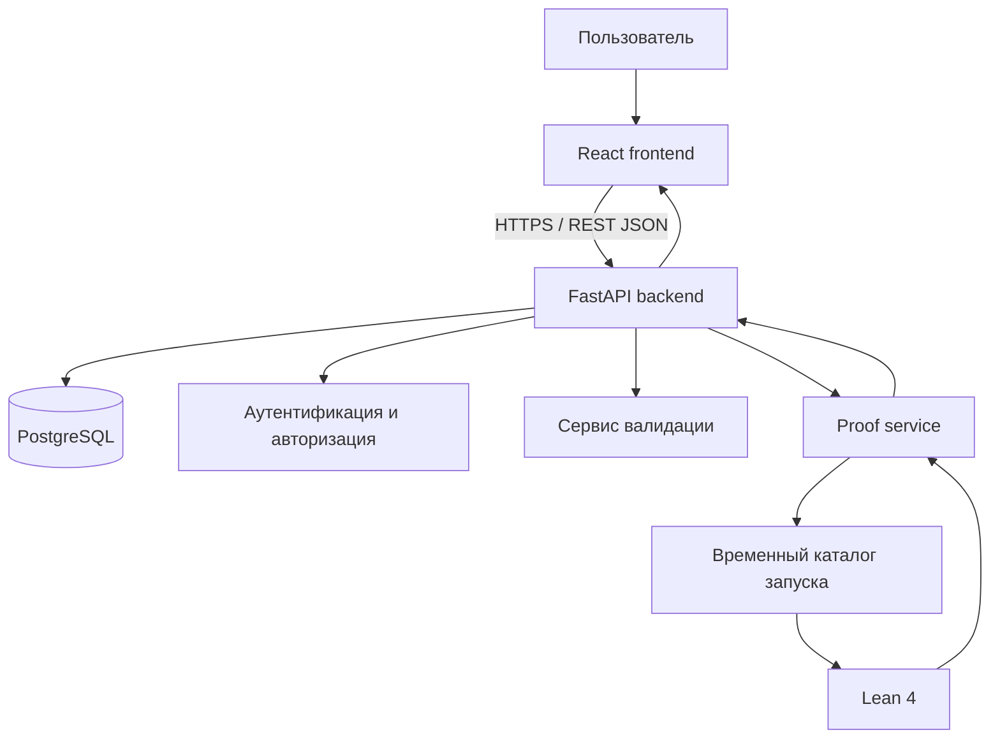
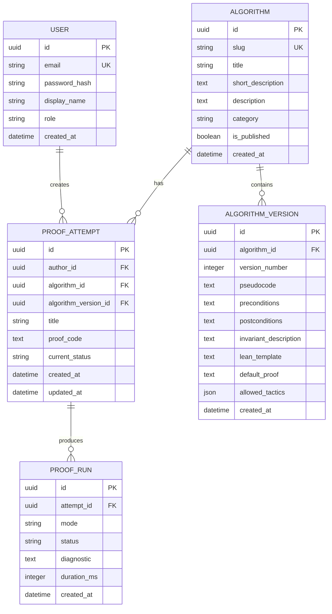

# Дизайн-документ

## Курсовая работа по дисциплине «Интернет-программирование»

**Тема:** «Разработка системы автоматического доказательства корректности алгоритмов на основе интерактивного theorem proving»  
**Статус:** основной план проекта  
**Версия:** 1.0  
**Дата:** 19.10.2026

---

## 1. Назначение документа

Этот документ фиксирует границы, архитектурные решения, состав функций и порядок разработки проекта. Все последующие решения по коду, интерфейсу, базе данных, тестированию и пояснительной записке должны соответствовать ему.

Документ намеренно ограничивает задачу: система не пытается доказать корректность произвольной программы на любом языке. Она предоставляет веб-интерфейс для работы с ограниченным набором алгоритмов, их формальными спецификациями и интерактивными доказательствами в proof assistant Lean 4.

---

## 2. Концепция проекта

Разрабатывается fullstack веб-приложение, в котором пользователь может:

1. выбрать поддерживаемый алгоритм;
2. изучить его описание и формальную спецификацию;
3. запустить автоматическую проверку подготовленного доказательства;
4. увидеть результат проверки, цели и диагностические сообщения Lean 4;
5. дополнить или исправить доказательство в интерактивном редакторе;
6. сохранить попытку и вернуться к ней позднее.

Под «автоматическим доказательством» понимается автоматическая проверка доказательства и запуск тактик Lean 4 для разрешения типовых логических целей. Под «интерактивным theorem proving» понимается возможность пользователя управлять доказательством: выбирать шаги, редактировать тактики и повторно запускать проверку.

### 2.1. Пример пользовательского сценария

Пользователь выбирает алгоритм поиска максимума в массиве. Система показывает формальную цель:

> Для любого непустого массива результат алгоритма является элементом массива и не меньше каждого элемента массива.

Пользователь изучает предусловие, постусловие и инвариант цикла, затем запускает проверку. Сервер формирует Lean-файл из шаблона и пользовательского доказательного блока, передаёт его Lean 4 и возвращает результат. Если доказательство неполно, интерфейс отображает незакрытую цель и сообщение об ошибке. Пользователь корректирует шаги и повторяет запуск.

---

## 3. Цель и задачи

### 3.1. Цель

Разработать веб-систему для автоматизированной проверки корректности базовых алгоритмов с использованием формальных спецификаций и интерактивного доказательства теорем в Lean 4.

### 3.2. Задачи

1. Проанализировать предметную область формальной верификации алгоритмов и существующие proof assistant.
2. Спроектировать архитектуру fullstack веб-приложения.
3. Реализовать каталог поддерживаемых алгоритмов и их формальных моделей.
4. Реализовать редактор и запуск доказательств.
5. Интегрировать серверную часть с Lean 4.
6. Обеспечить сохранение пользователей, алгоритмов и попыток доказательства.
7. Реализовать валидацию входных данных, обработку ошибок и ограничение ресурсов запуска Lean.
8. Провести функциональное тестирование, включая контрольные примеры успешных и ошибочных доказательств.
9. Подготовить пользовательскую документацию и материалы для демонстрации.

---

## 4. Границы проекта

### 4.1. Что входит в MVP

- регистрация, вход и выход пользователя;
- просмотр каталога алгоритмов;
- просмотр теоретического описания алгоритма и его спецификации;
- создание попытки доказательства для поддерживаемого алгоритма;
- веб-редактор доказательного блока Lean;
- запуск Lean 4 на сервере и отображение результата;
- автоматический запуск заданного набора безопасных тактик для учебных примеров;
- сохранение истории попыток пользователя;
- вывод статусов: «доказано», «не доказано», «ошибка спецификации/синтаксиса», «превышено время выполнения»;
- адаптивный графический интерфейс;
- базовая административная возможность добавлять алгоритмы и шаблоны.

### 4.2. Поддерживаемые алгоритмы первой версии

| Алгоритм | Доказываемое свойство |
|---|---|
| Поиск максимума в списке | Результат не меньше каждого элемента списка |
| Сумма элементов списка | Результат равен сумме всех элементов списка |
| Линейный поиск | При успехе найденный индекс указывает на искомое значение; при неуспехе значения нет в списке |
| Алгоритм Евклида | Результат является наибольшим общим делителем двух натуральных чисел |

Минимальный обязательный набор для демонстрации — поиск максимума и линейный поиск. Остальные алгоритмы добавляются после стабильной реализации базового контура.

### 4.3. Что не входит в MVP

- доказательство корректности произвольного JavaScript-, Python-, C++- или другого исходного кода;
- компиляция и запуск пользовательских программ;
- генерация полноценного доказательства нейросетью;
- совместное редактирование в реальном времени;
- экспорт доказательств в формальные библиотеки других proof assistant;
- полноценная IDE Lean в браузере.

Такие возможности могут быть описаны как перспективы развития, но не являются критериями готовности курсового проекта.

---

## 5. Пользователи и роли

| Роль | Возможности |
|---|---|
| Гость | Просмотр главной страницы и каталога алгоритмов; запуск доказательства недоступен |
| Пользователь | Регистрация, вход, просмотр алгоритмов, создание, редактирование, запуск и сохранение собственных попыток |
| Администратор | Возможности пользователя, а также создание и изменение карточек алгоритмов и шаблонов доказательств |

Для демонстрации допускается наличие заранее созданной учётной записи администратора через начальную миграцию или команду инициализации. Пароли хранятся исключительно в виде криптографических хешей.

---

## 6. Функциональные требования

### FR-01. Аутентификация

Система должна позволять пользователю зарегистрироваться, войти в систему и завершить сеанс. При регистрации проверяются уникальность e-mail, допустимая длина имени и надёжность пароля.

### FR-02. Каталог алгоритмов

Система должна выводить список доступных алгоритмов с названием, кратким описанием, категорией и уровнем сложности. Пользователь должен иметь возможность открыть детальную страницу алгоритма.

### FR-03. Описание алгоритма и спецификации

Страница алгоритма должна содержать:

- назначение и текстовое описание алгоритма;
- псевдокод;
- входные и выходные данные;
- предусловия;
- постусловия;
- при необходимости — инвариант цикла и условие завершения;
- формализацию или её фрагмент на Lean 4;
- список доступных автоматических тактик.

### FR-04. Работа с попытками доказательств

Авторизованный пользователь должен иметь возможность создать попытку для конкретного алгоритма, назвать её, изменить текст доказательного блока и сохранить черновик.

### FR-05. Проверка доказательства

По команде пользователя сервер должен собрать временный Lean-файл из неизменяемого шаблона алгоритма и текста доказательства, выполнить Lean 4 с ограничением времени и вернуть:

- статус проверки;
- текстовую диагностику;
- время выполнения;
- при успешной проверке — подтверждение закрытия всех целей.

### FR-06. Автоматические тактики

Для каждого алгоритма может быть задана безопасная последовательность допустимых тактик. По отдельной команде «Автоматически попробовать» система формирует доказательство с этими тактиками и выполняет проверку. Результат не заменяет ручное редактирование и сохраняется как отдельная попытка или новая версия текущей попытки.

### FR-07. История

Пользователь должен видеть список своих попыток, дату последней проверки, алгоритм, статус и длительность запуска. Он может открыть или удалить только собственную попытку.

### FR-08. Администрирование алгоритмов

Администратор должен иметь возможность создавать и редактировать алгоритм, учебное описание, формальный шаблон, разрешённые тактики и стартовый доказательный блок.

---

## 7. Нефункциональные требования

| Идентификатор | Требование |
|---|---|
| NFR-01 | Интерфейс должен быть русскоязычным и пригодным для работы на экране шириной от 360 px. |
| NFR-02 | Пользовательские данные должны проходить серверную валидацию; валидация на клиенте используется только для удобства. |
| NFR-03 | Каждый запуск Lean должен иметь ограничение времени, например 10 секунд, и выполняться в отдельном временном каталоге. |
| NFR-04 | Шаблоны алгоритмов не должны редактироваться обычным пользователем. |
| NFR-05 | Сервер не должен запускать произвольные системные команды на основе пользовательского ввода. |
| NFR-06 | Ошибки Lean и API должны отображаться в понятном виде без раскрытия секретов, путей к файлам и трассировок сервера. |
| NFR-07 | Код должен иметь единый стиль, типизацию TypeScript/Python, форматирование и тесты критической логики. |
| NFR-08 | Все основные сценарии должны быть воспроизводимы локально по инструкции из README. |

---

## 8. Технологические решения

| Уровень | Выбранная технология | Причина выбора |
|---|---|---|
| Клиент | React + TypeScript + Vite | Компонентный UI, строгая типизация, быстрый цикл разработки |
| Стили | CSS Modules или обычный модульный CSS | Отсутствие лишней зависимости, предсказуемые стили |
| Сервер | FastAPI + Python | Удобное REST API, автоматическая OpenAPI-документация, простая интеграция с запуском Lean |
| ORM и миграции | SQLAlchemy + Alembic | Типизированная работа с БД и контролируемая схема |
| База данных | PostgreSQL; SQLite для локальной разработки | Соответствие fullstack-подходу и простота локального запуска |
| Аутентификация | JWT в HttpOnly cookie или безопасная серверная сессия | Защита маршрутов без хранения токена в localStorage |
| Proof assistant | Lean 4 | Современный инструмент интерактивного доказательства, удобен для учебных алгоритмов |
| Контейнеризация | Docker Compose | Воспроизводимое развёртывание API, клиента, БД и Lean-среды |
| Тестирование API | pytest + TestClient | Проверка валидации, авторизации и исполнения сценариев |
| Тестирование UI | Vitest + React Testing Library | Проверка компонентов и пользовательских состояний |

На ранней стадии допускается запуск frontend и backend локально без Docker. Контейнеризация добавляется до этапа итоговой демонстрации.

---

## 9. Архитектура



### 9.1. Frontend

Клиент отвечает за навигацию, формы, редактор доказательства, вывод статусов и истории. Он не принимает решений о правах доступа и не формирует команды для ОС. Клиент получает данные только через REST API.

### 9.2. Backend

Сервер разделяется на слои:

- **API router** — маршруты, коды ответов, получение данных запроса;
- **service layer** — бизнес-правила, контроль прав, создание версий попыток;
- **repository layer** — доступ к БД;
- **proof service** — безопасная сборка Lean-файла, запуск процесса, разбор результата;
- **validation layer** — проверки текста, идентификаторов и ограничений размера.

### 9.3. Proof service

Proof service получает только:

- идентификатор утверждённого шаблона алгоритма;
- доказательный блок пользователя;
- режим запуска: ручной или автоматический.

Он не принимает имя бинарного файла, путь к файлу или shell-команду от клиента. Сервис:

1. получает шаблон из БД или файловой библиотеки;
2. проверяет размер и допустимые конструкции пользовательского блока;
3. создаёт новый временный каталог;
4. записывает итоговый Lean-файл в UTF-8;
5. запускает фиксированную команду Lean 4 без оболочки shell;
6. прерывает процесс по тайм-ауту;
7. удаляет временные файлы;
8. возвращает нормализованный результат.

---

## 10. Модель данных

### 10.1. Сущности



### 10.2. Основные поля

| Сущность | Назначение |
|---|---|
| `users` | Учётные записи, роль и хеш пароля |
| `algorithms` | Карточка алгоритма, видимая в каталоге |
| `algorithm_versions` | Неизменяемая версия формализации; гарантирует воспроизводимость старых попыток |
| `proof_attempts` | Сохраняемая пользователем редакция доказательства |
| `proof_runs` | История запусков с результатом и диагностикой |

Версия алгоритма привязывается к попытке в момент её создания. Изменение администратором шаблона не должно менять уже созданные попытки и их историю.

---

## 11. API первой версии

Базовый префикс: `/api/v1`.

| Метод и маршрут | Назначение | Доступ |
|---|---|---|
| `POST /auth/register` | Регистрация | Гость |
| `POST /auth/login` | Вход | Гость |
| `POST /auth/logout` | Выход | Пользователь |
| `GET /auth/me` | Текущий пользователь | Пользователь |
| `GET /algorithms` | Каталог алгоритмов | Все |
| `GET /algorithms/{slug}` | Детальная карточка алгоритма | Все |
| `POST /algorithms/{id}/attempts` | Создать попытку | Пользователь |
| `GET /attempts` | Список собственных попыток | Пользователь |
| `GET /attempts/{id}` | Открыть попытку | Автор / администратор |
| `PATCH /attempts/{id}` | Сохранить черновик | Автор |
| `DELETE /attempts/{id}` | Удалить попытку | Автор |
| `POST /attempts/{id}/verify` | Проверить введённое доказательство | Автор |
| `POST /attempts/{id}/auto-prove` | Запустить доступные автоматические тактики | Автор |
| `GET /attempts/{id}/runs` | История запусков | Автор / администратор |
| `POST /admin/algorithms` | Создать алгоритм | Администратор |
| `PATCH /admin/algorithms/{id}` | Изменить алгоритм или создать новую версию | Администратор |

### 11.1. Пример проверки доказательства

**Запрос** `POST /api/v1/attempts/{id}/verify`

```json
{
  "proof_code": "by\n  simp\n"
}
```

**Успешный ответ**

```json
{
  "status": "proved",
  "duration_ms": 124,
  "diagnostic": "Доказательство успешно проверено Lean 4.",
  "run_id": "uuid"
}
```

**Ответ при незакрытой цели**

```json
{
  "status": "not_proved",
  "duration_ms": 138,
  "diagnostic": "Не удалось закрыть цель: ...",
  "run_id": "uuid"
}
```

---

## 12. Формат шаблона доказательства

Для каждого алгоритма хранится шаблон Lean 4 с единственной точкой вставки. Примерная структура:

```lean
import Mathlib

namespace CourseProject

-- Формализация алгоритма и утверждение о его корректности.
theorem maximum_correct (xs : List Nat) (h : xs ≠ []) :
    -- Формальная постусловие алгоритма.
    True := by
  {{USER_PROOF}}

end CourseProject
```

На практике утверждение будет содержательным, а не `True`; фрагмент выше показывает только механизм вставки. В шаблоне допускается ровно один маркер `{{USER_PROOF}}`. Если маркер отсутствует или встречается более одного раза, версия алгоритма не публикуется.

Для автоматического режима сервер подставляет заранее утверждённый блок тактик. Пользователь не получает возможность изменять импортируемые модули, запускать команды ОС или выбирать путь к Lean.

---

## 13. Страницы и пользовательский интерфейс

| Маршрут frontend | Экран | Содержимое |
|---|---|---|
| `/` | Главная | Назначение системы, объяснение theorem proving, ссылка на каталог |
| `/algorithms` | Каталог | Карточки алгоритмов, поиск и фильтрация по категории |
| `/algorithms/:slug` | Алгоритм | Описание, псевдокод, спецификация, создание попытки |
| `/attempts` | Мои доказательства | Таблица попыток и статусов |
| `/attempts/:id` | Рабочее место доказательства | Редактор, кнопки сохранения/проверки, панель результата, история запусков |
| `/login` | Вход | Форма аутентификации |
| `/register` | Регистрация | Форма регистрации |
| `/admin/algorithms` | Администрирование | Управление алгоритмами и версиями |

### 13.1. Экран рабочего места доказательства

Экран должен содержать:

- заголовок и версию алгоритма;
- сворачиваемую панель со спецификацией;
- редактор доказательства с моноширинным шрифтом;
- кнопки «Сохранить», «Проверить», «Автоматически попробовать»;
- понятный статус последнего запуска;
- панель диагностики Lean;
- историю запусков;
- индикатор загрузки во время проверки.

Для MVP допустим обычный многострочный `textarea` с подсветкой статусов. Полноценная подсветка синтаксиса через Monaco Editor не является обязательной и добавляется только после реализации основной функциональности.

---

## 14. Правила валидации и безопасности

1. Незарегистрированный пользователь не может создавать и запускать попытки.
2. Пользователь не может читать, изменять или удалять чужую попытку.
3. Текст доказательства ограничивается, например, 20 000 символами.
4. При создании шаблона проверяются обязательный маркер вставки и уникальность номера версии.
5. Lean запускается через API процесса с массивом аргументов, не через `shell=True` или его аналоги.
6. Временный каталог уникален для каждого запуска и удаляется независимо от результата.
7. Запуск ограничивается временем, а при контейнерном развёртывании — также памятью и числом процессов.
8. В API не возвращаются секреты, внутренние пути файловой системы и необработанные трассировки исключений.
9. Пароли хешируются современным алгоритмом из используемой библиотеки аутентификации.
10. Для cookie-аутентификации применяются флаги `HttpOnly`, `Secure` в production и подходящая защита от CSRF.

---

## 15. План тестирования

### 15.1. Модульные тесты backend

- валидация регистрации и входа;
- права доступа к попыткам;
- создание версии алгоритма;
- корректная сборка Lean-файла из шаблона;
- отсутствие/дублирование маркера `{{USER_PROOF}}`;
- обработка успешного, ошибочного и зависшего запуска Lean;
- корректное удаление временного каталога.

### 15.2. Интеграционные тесты API

- регистрация → вход → создание попытки → сохранение → проверка;
- запрет доступа одного пользователя к попытке другого;
- запуск заведомо корректного доказательства;
- запуск заведомо неполного доказательства;
- превышение лимита времени.

### 15.3. Тесты frontend

- отображение карточек алгоритмов;
- валидация форм регистрации и входа;
- отображение состояний загрузки, успеха и ошибки проверки;
- блокировка кнопок во время запуска;
- вывод истории запусков.

### 15.4. Контрольные примеры для демонстрации

| № | Действие | Ожидаемый результат |
|---|---|---|
| 1 | Запустить готовое доказательство поиска максимума | Статус «доказано» |
| 2 | Удалить существенный шаг из доказательства и запустить проверку | Статус «не доказано», диагностика Lean |
| 3 | Нажать «Автоматически попробовать» для поддерживаемого алгоритма | Система создаёт/проверяет автоматический блок и выводит результат |
| 4 | Отправить пустую попытку | Клиентская и серверная валидация сообщают об ошибке |
| 5 | Попытаться открыть чужую попытку по URL | Ответ 403 или 404 без раскрытия данных |

---

## 16. Этапы разработки

Этапы соответствуют требованию методички отразить техническое задание, эскизный, технический и рабочий проекты.

### Этап 1. Техническое задание и анализ

Результат:

- утверждённый дизайн-документ;
- анализ предметной области и аналогов;
- функциональные и нефункциональные требования;
- сценарии пользователей;
- перечень контрольных примеров.

### Этап 2. Эскизный проект

Результат:

- прототип структуры интерфейса;
- диаграмма архитектуры;
- ER-диаграмма;
- описание входных и выходных данных;
- подтверждение возможности локального запуска Lean 4.

### Этап 3. Технический проект

Результат:

- структура репозитория;
- схема БД и миграции;
- API-контракт;
- шаблоны Lean для первых алгоритмов;
- решения по аутентификации, правам и безопасному запуску proof service.

### Этап 4. Рабочий проект — backend

Порядок:

1. Настроить FastAPI, конфигурацию и подключение к БД.
2. Реализовать модели и миграции.
3. Реализовать регистрацию, вход, выход и проверку прав.
4. Реализовать каталог алгоритмов и администрирование.
5. Реализовать попытки доказательств и историю запусков.
6. Реализовать proof service и интеграцию с Lean 4.
7. Написать модульные и интеграционные тесты.

### Этап 5. Рабочий проект — frontend

Порядок:

1. Настроить React + TypeScript.
2. Реализовать общую навигацию и страницы аутентификации.
3. Реализовать каталог и страницу алгоритма.
4. Реализовать рабочее место доказательства.
5. Реализовать историю попыток и состояния ошибок.
6. Проверить адаптивность и доступность основных сценариев.

### Этап 6. Интеграция и испытания

Результат:

- сквозной сценарий от регистрации до успешного доказательства;
- контрольные примеры из раздела 15.4;
- исправленные обнаруженные ошибки;
- скриншоты фактической работы приложения.

### Этап 7. Внедрение и документация

Результат:

- инструкция локального запуска в `README.md`;
- Docker Compose или иной воспроизводимый способ развёртывания;
- описание контрольного примера;
- материалы для пояснительной записки и защиты.

---

## 17. Планируемая структура репозитория

```text
.
├── DESIGN.md
├── README.md
├── docs/
│   ├── api.md
│   ├── formalization.md
│   └── screenshots/
├── backend/
│   ├── app/
│   │   ├── api/
│   │   ├── core/
│   │   ├── db/
│   │   ├── models/
│   │   ├── repositories/
│   │   ├── schemas/
│   │   └── services/
│   ├── alembic/
│   ├── tests/
│   └── requirements.txt
├── frontend/
│   ├── src/
│   │   ├── api/
│   │   ├── components/
│   │   ├── pages/
│   │   ├── types/
│   │   └── styles/
│   └── package.json
├── lean/
│   ├── templates/
│   └── examples/
├── docker-compose.yml
└── .env.example
```

Фактическая структура может уточняться только если это упрощает реализацию и не нарушает выделение frontend, backend и формальных шаблонов.

---

## 18. Риски и решения

| Риск | Вероятность / влияние | Решение |
|---|---|---|
| Сложность формализации алгоритмов в Lean | Средняя / высокая | Начать с двух простых алгоритмов, использовать готовые библиотеки Mathlib, не поддерживать произвольный код |
| Зависание или ресурсоёмкое доказательство | Средняя / высокая | Тайм-аут, временные каталоги, ограничения контейнера, ограничение размера доказательства |
| Сложность развёртывания Lean на Windows | Средняя / средняя | Зафиксировать версию Lean/elan, добавить Docker-вариант, документировать локальную установку |
| Слишком большой объём frontend-функций | Средняя / средняя | Использовать textarea вместо сложной браузерной IDE, не добавлять совместное редактирование и генеративный ИИ |
| Непонятные сообщения Lean для пользователя | Высокая / средняя | Показывать исходную диагностику и короткое русскоязычное описание статуса; подготовить примеры |
| Возможность опасных пользовательских инструкций | Низкая / высокая | Не исполнять пользовательский код как shell-команду, хранить неизменяемые шаблоны, запускать Lean изолированно |

---

## 19. Критерии готовности MVP

MVP считается готовым, если выполняются все условия:

1. Приложение запускается по документированной инструкции.
2. Пользователь может зарегистрироваться и войти.
3. В каталоге доступны минимум два алгоритма.
4. Для каждого алгоритма есть описание, псевдокод и формальная спецификация.
5. Пользователь может создать и сохранить попытку доказательства.
6. Сервер запускает Lean 4 и возвращает успешный или ошибочный результат.
7. Заведомо корректный пример получает статус «доказано».
8. Заведомо неполный пример получает статус «не доказано» с диагностикой.
9. История запусков сохраняется.
10. Пользователь не имеет доступа к попыткам других пользователей.
11. Пройдены контрольные примеры и подготовлены скриншоты для демонстрации.

---

## 20. Материалы для пояснительной записки

Проект заранее формирует основу для обязательных разделов курсовой работы:

| Раздел пояснительной записки | Материал из проекта |
|---|---|
| Анализ предметной области | Разделы 2–4 этого документа, анализ Lean/Coq/Why3 и аналогов |
| Техническое задание | Разделы 3, 6 и 7 |
| Моделирование и разработка | Архитектура, ER-диаграмма, API, алгоритм proof service |
| Описание веб-приложения | Структура frontend/backend, модель данных, входные и выходные данные |
| Инструкция по эксплуатации | README, порядок запуска, контрольные примеры |
| Заключение | Критерии готовности, результаты тестирования и ограничения MVP |

---

## 21. Принятые решения

1. Проект реализуется как fullstack веб-приложение с React frontend и FastAPI backend.
2. Для интерактивного theorem proving используется Lean 4.
3. Первая версия работает с заранее подготовленными формальными моделями алгоритмов, а не с произвольным исходным кодом.
4. Пользователь редактирует только доказательный блок, который подставляется в контролируемый шаблон Lean.
5. Доказательство запускается только на сервере с ограничением времени и без shell-интерпретации пользовательского текста.
6. Минимальный демонстрационный набор состоит из алгоритмов поиска максимума и линейного поиска.
7. Все последующие изменения архитектуры фиксируются в этом документе отдельной записью с обоснованием.

---

## 22. Текущий статус и ближайшие задачи

**Дата фиксации:** 19.10.2026  
**Состояние:** готов первый рабочий прототип; полный MVP из раздела 19 ещё не завершён.

### 22.1. Выполнено

- Инициализирован Git-репозиторий, подключён и отправлен первый коммит в `origin/main`.
- Созданы React + TypeScript frontend и FastAPI backend.
- Реализованы публичные маршруты API состояния системы и каталога алгоритмов.
- В каталоге доступны учебные карточки поиска максимума в списке и линейного поиска.
- Реализовано рабочее место с просмотром спецификации, псевдокода, редактором доказательного блока и панелью результата проверки.
- Добавлен изолированный `ProofRunner`: временный каталог для запуска, ограничение времени, фиксированная серверная команда Lean и запрет shell-интерпретации пользовательского текста.
- Подключён Lean 4.35.0 и создан локальный Lean-проект.
- Формально доказано ключевое свойство поиска максимума: каждый элемент непустого входного списка натуральных чисел не превышает вычисленный алгоритмом результат.
- API проверяет это доказательство через Lean 4; для линейного поиска до появления формальной модели возвращается явный статус недоступности проверки.
- Подготовлены инструкции запуска в `README.md`.

### 22.2. Подтверждённые проверки

| Проверка | Результат |
|---|---|
| `lake build` в `lean/` | Успешно |
| `py -m pytest` в `backend/` | 8 тестов пройдено, включая реальную проверку Lean через API |
| `npm run build` в `frontend/` | Успешно |
| `npm run lint` в `frontend/` | 0 ошибок и предупреждений |
| Ручная проверка в браузере | Подтверждена: каталог, редактор и успешное доказательство работают |

### 22.3. Ограничения текущей версии

- Каталог и формальные шаблоны пока хранятся в памяти процесса, не в базе данных.
- Нет регистрации, аутентификации и ролей пользователей.
- Попытки доказательств и история запусков не сохраняются.
- Предметная Lean-модель реализована только для поиска максимума; линейный поиск пока демонстрируется как карточка без проверяемого шаблона.
- Автоматический режим тактик, административное управление алгоритмами и Docker-развёртывание ещё не реализованы.

### 22.4. Ближайший порядок работ

1. Добавить PostgreSQL, SQLAlchemy, Alembic и миграции для сущностей `users`, `algorithms`, `algorithm_versions`, `proof_attempts`, `proof_runs`.
2. Реализовать регистрацию, вход, выход и разграничение доступа к попыткам доказательств.
3. Перевести каталог алгоритмов и шаблоны Lean из памяти в базу данных; подготовить начальные данные миграцией или командой инициализации.
4. Реализовать создание, редактирование, сохранение и удаление пользовательских попыток, а также просмотр истории запусков.
5. Формализовать и подключить к API алгоритм линейного поиска.
6. Добавить автоматический режим допустимых тактик и проверку прав администратора для управления алгоритмами.
7. Подготовить Docker Compose, скриншоты фактической работы и материалы пояснительной записки.
